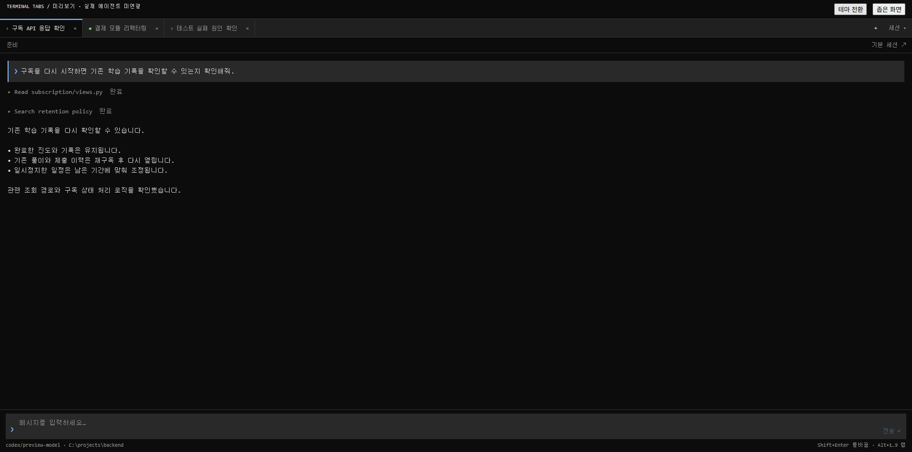

# Terminal Tabs

Paseo 0.12.x용 플러그인. 터미널처럼 위쪽 탭으로 세션을 전환하고, 대화와 입력창에 집중합니다. 공식 플러그인 화면 안에서 동작합니다.



## 사용

플러그인은 활성화하고 **사이드바의 Terminal Tabs 버튼만 숨깁니다.** 대화 화면 등록과 기존 연결은 유지합니다. Terminal Tabs 화면의 **+ 세션 열기**에서 기존 세션을 선택하고, 위쪽 **+**로 다른 세션을 열거나 새 세션을 만듭니다. 새 세션 생성에 필요한 `프로바이더/모델 ID`는 현재 선택한 세션에서 가져오며 직접 수정할 수 있습니다. 공급자 기본 권한 정책을 그대로 사용합니다.

- 탭을 닫아도 에이전트는 계속 실행됩니다. 세션 목록에서 다시 열 수 있습니다.
- 입력 초안은 호스트와 세션별로 보관하며 화면·호스트 전환 후 복원합니다. 데스크톱·웹에서는 입력 중 짧은 간격으로 로컬 저장하고 화면을 닫거나 새로고침할 때 남은 변경을 저장합니다. 전송한 내용과 같은 초안만 성공 후 지우며, 전송 중 새로 쓴 내용은 유지합니다.
- 저장소가 차단된 환경과 모바일에서는 현재 앱 실행 중 메모리에 초안을 보관합니다. 여러 창의 초안은 실시간 동기화하지 않으며, 같은 호스트·세션을 여러 창에서 편집하면 마지막으로 저장한 내용이 다음 실행에 복원됩니다.
- 데스크톱·웹에서는 탭 순서와 마지막 선택을 해당 클라이언트의 호스트별 로컬 저장소에 보관합니다. 모바일 및 저장소가 차단된 환경에서는 메모리에만 보관합니다.
- 선택한 탭만 타임라인을 구독합니다. 최근 세 대화의 화면·스크롤 위치·펼친 상세는 유지하고, 비활성 대화와 세션 선택 창에서는 대화 구독을 해제합니다. 닫은 탭은 즉시 화면을 해제하며, 오래된 화면은 다시 열 때 최근 이력 캐시로 시작합니다. 최신 160개 항목을 가상 목록으로 표시하고 이벤트를 350ms 단위로 병합해 새 스냅샷을 읽습니다. 다른 탭의 에이전트 작업은 계속됩니다.
- 세션 목록은 별도 공식 구독으로 상태 변경을 받습니다. 초기 조회·재연결 중 들어온 변경을 병합하고 화면을 닫을 때 구독을 해제합니다. 조회 오류는 제한된 간격으로 재시도하며 세션 선택 창에서 수동 새로고침할 수 있습니다.
- 도구 실행과 생각 과정은 접어서 표시합니다. 상세 출력은 항목당 16,000자까지 표시합니다.
- 이전 기록, 승인·질문 응답, 작업 중단, 모델 변경, 첨부파일, 슬래시 명령 선택 등은 **기본 세션 ↗**에서 처리합니다.
- 작업 중에는 다음 메시지 초안을 작성할 수 있고, 전송은 작업이 끝난 후 가능합니다. 메시지 전송 실패 시 초안을 보존합니다.

| 단축키 (데스크톱·웹) | 동작 |
| --- | --- |
| Enter | 전송 |
| Shift+Enter | 줄바꿈 |
| Alt+1…9 | 해당 순서 탭 선택 |
| Ctrl/Cmd+PageUp / PageDown | 이전 / 다음 탭 |
| Ctrl/Cmd+Shift+T | 세션 선택 창 |
| Ctrl/Cmd+Shift+W | 현재 탭 닫기 |

한글 조합 중 Enter는 전송하지 않습니다. 브라우저가 먼저 처리하는 단축키는 상단 탭이나 버튼으로 사용할 수 있습니다.

## 설치

사용 PC에는 **Paseo만 설치**하면 됩니다. 플러그인 폴더를 복사해 설치하며 pnpm·Node.js·client/protocol 패키지를 따로 설치하지 않습니다. 타입은 Paseo 공개 SDK 반환형에서 유도합니다. React·React Native·SDK는 Paseo가 제공합니다. 아래 개발용 패키지는 개발 PC에서만 사용합니다.

이 플러그인의 동작을 검토한 후 Paseo **Settings → Plugins → Enable plugins**를 켭니다. 전체 플러그인 실행 스위치이므로 자동으로 켜지 않습니다.

같은 화면의 Plugin source에 이 폴더의 절대 경로를 붙여 넣고 설치합니다.

```text
C:\Users\ckdgh\Desktop\projects\paseo\파세오
```

Windows 번들 CLI를 사용해도 됩니다.

```powershell
& "C:\Program Files\Paseo\resources\bin\paseo.cmd" plugin install "C:\Users\ckdgh\Desktop\projects\paseo\파세오"
& "C:\Program Files\Paseo\resources\bin\paseo.cmd" plugin ls
```

수정 후 `paseo plugin reload terminal-tabs`로 반영합니다. 플러그인에는 서버 엔트리나 추가 데몬 프로세스가 없습니다. 기본 Paseo 창의 타이틀바·사이드바를 제거하는 기능은 공개 SDK에 없어 변경하지 않습니다. 앱 전체 메모리 사용량의 감소율은 측정하지 않았습니다.

## 개발 및 미리보기

```powershell
pnpm install
pnpm typecheck
pnpm test
pnpm check:bundle
pnpm preview
```

`http://127.0.0.1:5173`에서 실제 플러그인 컴포넌트를 샘플 세션으로 확인합니다. 미리보기는 실제 데몬이나 에이전트에 연결하지 않습니다. 테마·좁은 화면 전환, 탭 전환, 초안 보존, 메시지 전송, 세션 생성 UI를 확인할 수 있습니다. 미리보기 도구와 React Native Web은 개발 의존성이며 Paseo에 설치되는 런타임 번들에는 포함되지 않습니다.

`pnpm preview:build`는 미리보기만 빌드합니다. 실제 플러그인은 Paseo가 `index.client.tsx`에서 빌드하며, 호스트가 React·React Native·SDK를 제공합니다.

구독 정리, 이전 탭의 지연 응답 무시, 이벤트 병합, 재연결, 목록 페이지네이션·제거 처리를 테스트합니다. 실제 데몬에서의 설치와 에이전트 메시지 왕복은 플러그인 기능을 켠 후 별도로 확인해야 합니다.

공식 문서: [플러그인 빠른 시작](https://paseo.sh/docs/plugins), [플러그인 API](https://paseo.sh/docs/plugins/reference).
